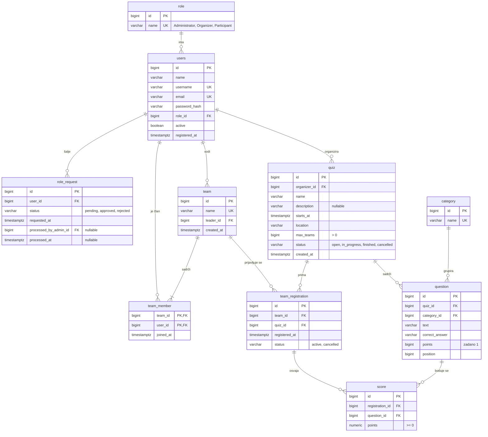

# Pub Kviz – ER dijagram baze podataka (T-02)

Dijagram je u Mermaid formatu – GitHub ga automatski iscrtava kad se ova datoteka otvori u repozitoriju. Nazivi tablica i stupaca jednaki su onima u migraciji `backend/src/main/resources/db/migration/V2__create_schema.sql`, a tipovi odgovaraju PostgreSQL-u 16 (`bigint` ključevi se u SQL-u pišu kao `BIGSERIAL`).

## Ključevi i pravila

| Tablica | PK | FK | Jedinstvenost / pravila |
|---|---|---|---|
| role | id | – | name jedinstven |
| users | id | role_id → role | email i username jedinstveni; lozinka samo kao hash (T-06); `active = false` blokira prijavu (T-33) |
| role_request | id | user_id, processed_by_admin_id → users | US-27 / T-32 |
| quiz | id | organizer_id → users | max_teams > 0; novi kviz ima status `open` (T-12) |
| category | id | – | name jedinstven |
| question | id | quiz_id → quiz, category_id → category | position određuje redoslijed prikaza (T-25) |
| team | id | leader_id → users | name jedinstven (T-20); voditelj se upisuje i u team_member |
| team_member | (team_id, user_id) | team_id → team, user_id → users | spojna tablica M:N korisnik–tim |
| team_registration | id | team_id → team, quiz_id → quiz | UNIQUE (team_id, quiz_id) – tim se ne prijavljuje dvaput (T-21) |
| score | id | registration_id → team_registration, question_id → question | UNIQUE (registration_id, question_id); points ≥ 0 (T-26) |

## Odluke koje tim treba potvrditi

1. **Bodovi po pitanju, ne po rundi.** `score` veže prijavu tima i pitanje, pa se ukupni zbroj tima dobije kao `SUM(points)`. Ako želite bodovanje po rundama, dodajte tablicu `round` i zamijenite `question_id` s `round_id`.
2. **Rang se ne sprema, nego se računa** iz zbroja bodova (T-28). Ako povijest kvizova (T-31) postane spora, može se dodati stupac `placement` u `team_registration` koji se popuni pri završetku kviza.
3. **Kategorije su zajedničke** svim organizatorima. Ako svaki organizator treba svoje, dodajte `organizer_id FK` u `category`.
4. **Ponovna prijava nakon otkazivanja**: zbog UNIQUE (team_id, quiz_id) otkazana prijava se ponovno aktivira promjenom statusa, a ne novim retkom.
5. **Broj slobodnih mjesta** = `max_teams − COUNT(aktivnih prijava)`; ne sprema se posebno.
