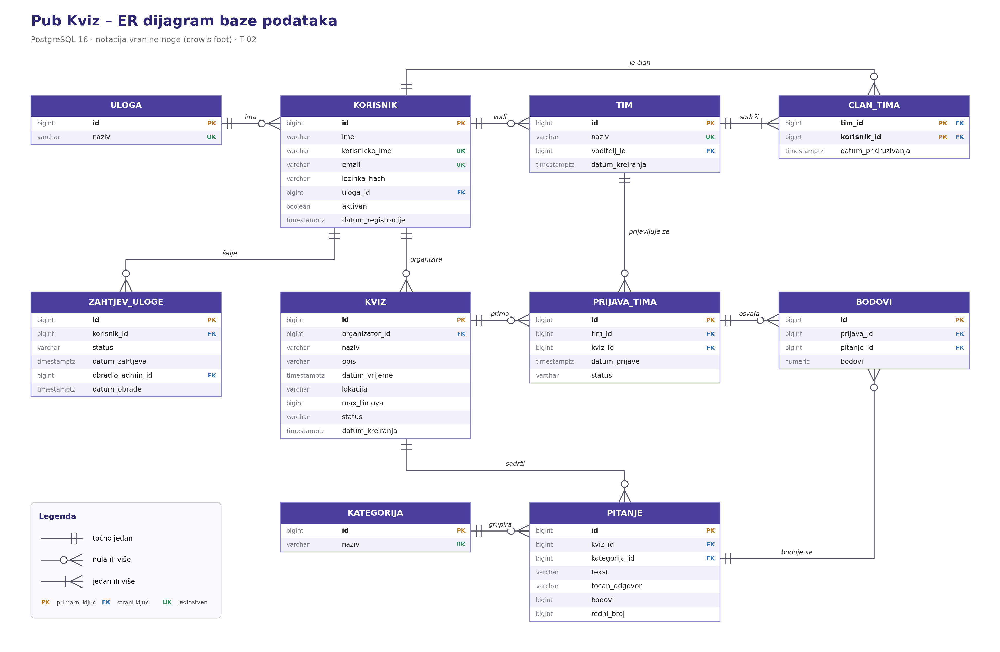
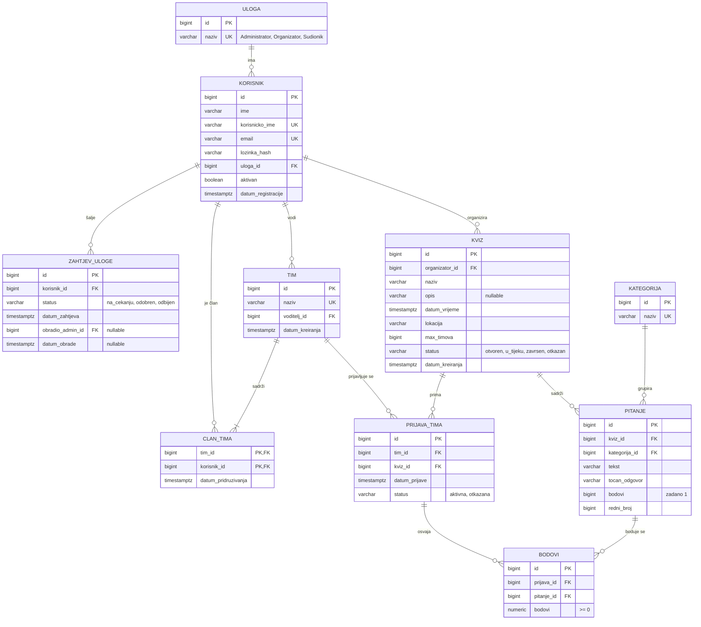

# Pub Kviz – ER dijagram baze podataka (T-02)

Dijagram je u Mermaid formatu – GitHub ga automatski iscrtava kad se ova datoteka otvori u repozitoriju. Tipovi stupaca odgovaraju PostgreSQL-u 16 (baza projekta); `bigint` ključevi se u Flyway migracijama pišu kao `BIGSERIAL`, kao u `V1__create_item.sql`.

## Ključevi i pravila

| Tablica | PK | FK | Jedinstvenost / pravila |
|---|---|---|---|
| ULOGA | id | – | naziv jedinstven |
| KORISNIK | id | uloga_id → ULOGA | email i korisnicko_ime jedinstveni; lozinka samo kao hash (T-06); `aktivan = false` blokira prijavu (T-33) |
| ZAHTJEV_ULOGE | id | korisnik_id, obradio_admin_id → KORISNIK | US-27 / T-32 |
| KVIZ | id | organizator_id → KORISNIK | max_timova > 0; novi kviz ima status `otvoren` (T-12) |
| KATEGORIJA | id | – | naziv jedinstven |
| PITANJE | id | kviz_id → KVIZ, kategorija_id → KATEGORIJA | redni_broj određuje redoslijed prikaza (T-25) |
| TIM | id | voditelj_id → KORISNIK | naziv jedinstven (T-20); voditelj se upisuje i u CLAN_TIMA |
| CLAN_TIMA | (tim_id, korisnik_id) | tim_id → TIM, korisnik_id → KORISNIK | spojna tablica M:N korisnik–tim |
| PRIJAVA_TIMA | id | tim_id → TIM, kviz_id → KVIZ | UNIQUE (tim_id, kviz_id) – tim se ne prijavljuje dvaput (T-21) |
| BODOVI | id | prijava_id → PRIJAVA_TIMA, pitanje_id → PITANJE | UNIQUE (prijava_id, pitanje_id); bodovi ≥ 0 (T-26) |

## Odluke koje tim treba potvrditi

1. **Bodovi po pitanju, ne po rundi.** BODOVI veže prijavu tima i pitanje, pa se ukupni zbroj tima dobije kao `SUM(bodovi)`. Ako želite bodovanje po rundama, dodajte tablicu RUNDA i zamijenite `pitanje_id` s `runda_id`.
2. **Rang se ne sprema, nego se računa** iz zbroja bodova (T-28). Ako povijest kvizova (T-31) postane spora, može se dodati stupac `plasman` u PRIJAVA_TIMA koji se popuni pri završetku kviza.
3. **Kategorije su zajedničke** svim organizatorima. Ako svaki organizator treba svoje, dodajte `organizator_id FK` u KATEGORIJA.
4. **Ponovna prijava nakon otkazivanja**: zbog UNIQUE (tim_id, kviz_id) otkazana prijava se ponovno aktivira promjenom statusa, a ne novim retkom.
5. **Broj slobodnih mjesta** = `max_timova − COUNT(aktivnih prijava)`; ne sprema se posebno.
